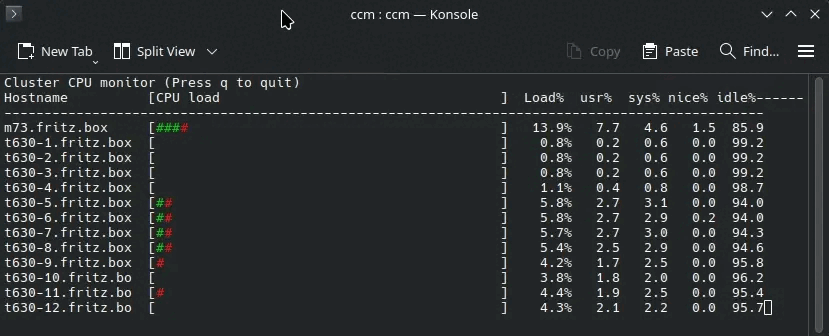

# Cluster CPU, GPU, Memory & Temperature monitor

Ncurses-based CLI tool that monitors CPU, GPU and memory usage, as well as CPU temperature across multiple hosts via SSH (or `talosctl` for [Talos Linux](https://www.talos.dev/) nodes) and displays real-time horizontal bar graphs:



## Supported Systems

`ccm` supports running on and monitoring both **Linux** and **FreeBSD** systems over SSH, and **Talos Linux** nodes through `talosctl`.

## GPU load

On Linux and Talos Linux hosts with an **AMD GPU** (`amdgpu` driver), `ccm`
shows the GPU load as a third bar next to CPU and memory. The value is the
driver's `gpu_busy_percent`, read from
`/sys/class/drm/card*/device/gpu_busy_percent`. This includes integrated AMD
GPUs.

- The GPU bar appears as soon as one host reports a GPU and the terminal is at
  least 90 columns wide. In narrower terminals, or if no host has a GPU, the
  display looks the same as without GPU support.
- Hosts without a supported GPU show `n/a` in the GPU bar.
- NVIDIA and Intel GPUs, and FreeBSD hosts, are not supported yet because they
  do not provide this counter.

## Requirements

- GCC
- ncurses and pthreads libraries
- SSH access to target hosts with key-based authentication
- For Talos Linux nodes: [`talosctl`](https://www.talos.dev/latest/learn-more/talosctl/) in `PATH` and a working talosconfig (see [Talos Linux nodes](#talos-linux-nodes))

## Build

```bash
make  # Linux
gmake # FreeBSD
```

## Installation

```bash
# Edit the example config and install it system-wide
edit ccm.conf.example
sudo cp ccm.conf.example /etc/ccm.conf

# Or copy it to your home directory for user-wide configuration
cp ccm.conf.example ~/.ccmrc
```

## Usage

1. Add hostnames to `hosts.txt` (one per line, `#` for comments)
2. If `hosts.txt` is not found, `~/.ccmrc` is checked
3. If neither exists, `/etc/ccm.conf` is used as fallback
4. Run: `./ccm` or `make run`
5. Press `q` or `ESC` to quit

### Command Line Options

```
./ccm [-n SEC] [--hostfile FILE] [-H HOSTS] [-t N] [-h] [-v]
```

- `--interval, -n SEC` - Update interval in seconds (default: 0.5)
- `--hostfile FILE` - Use specified hosts file (default: hosts.txt, fallback: ~/.ccmrc, then /etc/ccm.conf)
- `-H, --hosts LIST` - Comma-separated list of hosts to monitor
- `-t, --threads N` - Number of parallel SSH/talosctl threads (default: 4)
- `-h, --help` - Show help message
- `-v, --version` - Show version information

### Examples

```bash
# Monitor hosts from file
./ccm --hostfile myhosts.txt

# Monitor specific hosts
./ccm -H "node1,node2,node3"

# Combine host file and command-line hosts
./ccm --hostfile hosts.txt -H "extra1,extra2"

# Mix SSH hosts and Talos Linux nodes
./ccm -H "node1,talos:192.168.1.10,talos:192.168.1.11"
```

## Hosts File Format

```
# Comments start with #
localhost
node1
node2
node3

# Talos Linux nodes are queried with talosctl instead of SSH
talos:192.168.1.10
talos:192.168.1.11
```

A plain hostname is queried over SSH. A `talos:` prefix selects `talosctl`
instead; this works in the hosts file and in the `-H` list alike.

## Talos Linux nodes

Talos Linux has no shell and no SSH, so `ccm` reads `/proc/stat`,
`/proc/meminfo` and the CPU temperature sensor from `/sys` through the Talos API
using `talosctl read`. CPU usage is calculated from the difference between two
samples of the cumulative counters, so a node's first reading takes a fraction
of a second longer than later ones.

- `talosctl` is run as `talosctl --nodes=<host> read <file>` and uses your
  current talosconfig: `$TALOSCONFIG` if set, otherwise `~/.talos/config`, with
  the endpoints of the current context. To monitor another cluster, export
  `TALOSCONFIG` before starting `ccm`, or switch the current context with
  `talosctl config context`.
- The `<host>` after `talos:` is the node address as you would pass it to
  `talosctl -n`. Use the names exactly as `talosctl get members` lists them
  (HOSTNAME column), or the node IPs. A node's certificate is only valid for its
  own Talos hostname and IPs, so `talos:cube04.fritz.box` fails with an x509
  error if the node calls itself just `cube04`.
- If a node shows `--.-`, run `talosctl --nodes=<host> read /proc/stat` to see
  the underlying error.
- Each `talosctl` call is stopped after 3 seconds, so an unreachable node is
  shown as failed (`--.-`) without blocking the display.
- The temperature column shows `---` if the node exposes no CPU sensor, e.g. in
  a virtual machine.

## Author / Issues / Pull requests / License

 * Jakob Flierl - https://github.com/koppi - Initial release

This is an early release. The repository can be forked; issues and pull requests are welcome.

Licensed under [MIT](LICENSE).
